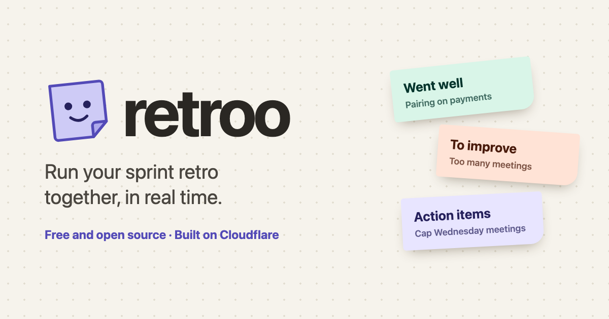

# retroo

**A Cloudflare-first retro board.** Run your sprint retro together, in real time, on Workers, Durable Objects and D1. It fits in Cloudflare's free tier.



Try it without an account at `/demo` on any deployment (for example [retroo.rzrn.dev/demo](https://retroo.rzrn.dev/demo)): a sample board that lives in your browser.

## Features

- **Hidden until reveal:** write privately, then flip everyone's cards at once.
- **Reactions and comments** on every card.
- **Team mood** each sprint, compared with the last one.
- **Action items carry over** to the next sprint until they're done.
- **Summary** at the end, copyable as Markdown for Slack, Confluence or Notion.
- **Mood trend** across sprints on Past boards.
- **Anonymous cards**: nobody sees who wrote what; comments and reactions show names.
- **Presenter view**, **shared timer**, **doodle wall** and **emoji rain**.
- **Join with a code**; one shared password to create boards.

## How it works

```
Browser (Vue)  ──WebSocket──►  Worker  ──►  Durable Object "Board" (one per board, SQLite inside)
                                  │
                                  └──────►  D1 (index of boards, for Past boards and carry-over)
```

- **Worker** (`src/worker.ts`) serves the built app and routes `/api/*`.
- **Board Durable Object** holds a board's cards, reactions, comments, moods and doodle in its own SQLite, and pushes updates to everyone over hibernating WebSockets.
- **D1** stores only the list of boards.
- **Frontend** is Vue 3 + Vite with the Cloudflare Vite plugin, so `pnpm dev` runs the real Worker and Durable Objects locally.
- Tooling is the [`cf` CLI](https://github.com/cloudflare/cf) (beta) with `cloudflare.config.ts`.

## Develop

Needs Node 22.18+ and pnpm.

```sh
pnpm install
cp .dev.vars.example .dev.vars   # set CREATE_PASSWORD for local use
pnpm dev                         # http://localhost:5173
```

```sh
pnpm typecheck   # Worker (tsc) and Vue screens (vue-tsc)
pnpm test        # runs the real Worker + Durable Object in memory; needs .dev.vars
```

Local data lives in `.cloudflare/state/`. Delete that folder to start fresh.

## Deploy your own

1. **Log in** (once per machine):

   ```sh
   pnpm exec cf auth login
   ```

2. **Pick your domain.** It must be a zone on your Cloudflare account. Change it in two places:

   - `cloudflare.config.ts`, `domains: ["retroo.rzrn.dev"]`. Remove the line to use the free `*.workers.dev` address instead.
   - `index.html`, the `og:url` and `og:image` tags (link previews need full URLs).

3. **Choose the password** used to create, list and lock boards (20+ random characters) and put it in `.env.secrets`, which git ignores:

   ```sh
   echo "CREATE_PASSWORD=your-long-random-password" > .env.secrets
   ```

4. **Deploy.** This builds the app, uploads the Worker with the password, creates the D1 database and the Durable Object class, and attaches the domain. No ids to copy into the config.

   ```sh
   pnpm run deploy --secrets-file .env.secrets
   ```

   Use `pnpm run deploy`, not `pnpm deploy`; the latter is a built-in pnpm command.

Later updates are just `pnpm run deploy`; data and the password stay. To change the password, edit `.env.secrets` and deploy with `--secrets-file` again.

### Free tier

Everything here is on the Workers Free plan: Durable Objects with SQLite storage, D1, and static assets. A team retro uses a tiny fraction of the daily limits (100k requests, 5 GB storage). Going over a limit makes requests fail until 00:00 UTC; it never bills you.

## Project layout

```
src/worker.ts         Worker routes and the Board Durable Object
src/Board.vue         The board screen
src/NoteCard.vue      A card with reactions and comments
src/Presenter.vue     Presenter view
src/Doodle.vue        Doodle wall
src/EmojiRain.vue     Emoji rain and combos
src/Timer.vue         Shared timer
src/Mascot.vue        Stickie, the mascot (also public/favicon.svg)
test/board.test.ts    Board rules, end to end
design/og.html        Source of the link preview image
```

### Social preview image

`public/og.png` is a screenshot of `design/og.html`. To rebuild it after editing:

```sh
"/Applications/Google Chrome.app/Contents/MacOS/Google Chrome" --headless=new --hide-scrollbars \
  --force-device-scale-factor=1 --window-size=1200,630 \
  --screenshot="$PWD/public/og.png" "file://$PWD/design/og.html"
```

## License

[MIT](LICENSE)
